# Docker Swarm Monitoring: Prometheus + Loki + Grafana + Alertmanager

**Задача:** подключить к микросервисному приложению в Docker Swarm (7 Spring Boot сервисов + PostgreSQL + RabbitMQ на 3 ВМ Vagrant) полный стек наблюдаемости: метрики кластера и приложения, сбор логов со всех нод, дашборд Grafana и алерты в email и Telegram.

> Код Spring Boot сервисов предоставлен учебной программой. Моя работа — это инфраструктура: Dockerfile, Docker Swarm, Nginx, Vagrant, стек мониторинга и автоматизация развертывания, а также метрики Micrometer, добавленные в 4 сервиса.

Инфраструктура приложения (Swarm на 3 ВМ, Nginx, сборка образов) описана в отдельном проекте [docker-compose-microservices](https://github.com/aminalkobaili-bash/docker-compose-microservices). Этот проект — следующий шаг: наблюдаемость.

**Стек:** Docker Swarm · Prometheus 3.16 · node-exporter · cAdvisor · blackbox-exporter · Loki 3.6 · Grafana Alloy 1.21 · Grafana 12.4 · Alertmanager 0.35 · Spring Boot Actuator + Micrometer · Nginx · Vagrant

Синтаксис сверен с документацией через Context7: Swarm `configs` с источником `file`, `version` в stack-файлах (нужен для `docker stack deploy`), компоненты Alloy `discovery.docker` / `loki.source.docker`, `bot_token_file` и `chat_id_file` в Alertmanager.

## Архитектура

### Метрики, логи и алерты

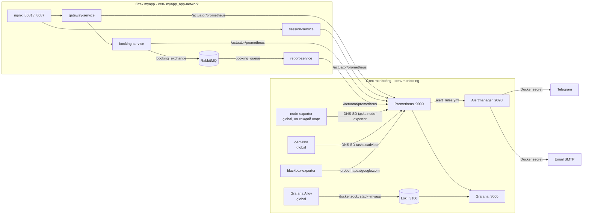

Prometheus подключён к двум overlay-сетям: `monitoring` и внешней `myapp_app-network`. Поэтому он обращается к Java-сервисам по именам из DNS Swarm. Global-сервисы (node-exporter, cAdvisor) находятся через `dns_sd_configs` по имени `tasks.<service>`: оно возвращает IP каждой реплики, то есть каждой ноды.

### Развёртывание

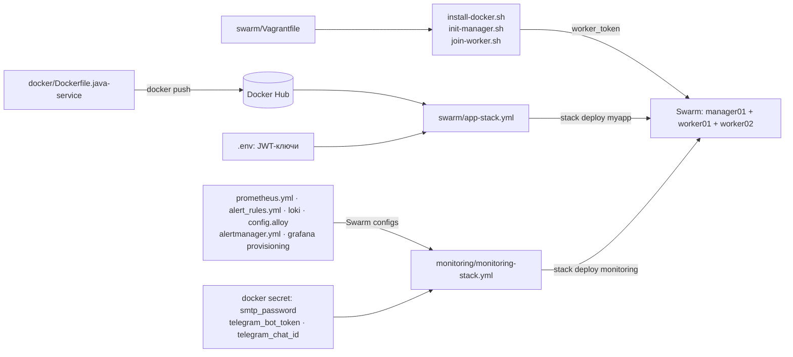

### Граф конфигурации (Graphify)

Граф построен [Graphify](https://github.com/safishamsi/graphify) по коду и конфигам репозитория: 1957 узлов, 3966 рёбер. 97% связей извлечены из файлов (`EXTRACTED`), оставшиеся 3% `INFERRED` относятся к Java-коду, в конфигах их нет. Graphify разбирает YAML структурно, поэтому на схеме ниже только связи, которые он нашёл внутри файлов. Связи между сервисами по сети (`alertmanager:9093`, `loki:3100`) записаны строками в значениях, они показаны на схемах выше.

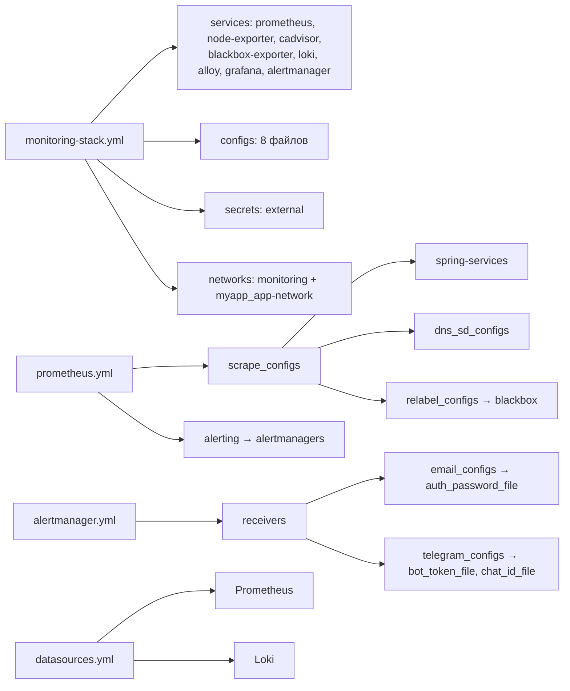

## Структура

```text
.
├── monitoring/
│   ├── monitoring-stack.yml          # 8 сервисов, Swarm configs и secrets
│   ├── prometheus/
│   │   ├── prometheus.yml            # 5 jobs: Java-сервисы, node-exporter, cAdvisor, blackbox, сам Prometheus
│   │   └── alert_rules.yml           # 3 правила: память ноды, RAM ноды, CPU сервиса
│   ├── alertmanager/alertmanager.yml # email + Telegram, все секреты из файлов
│   ├── loki/loki-config.yml          # одна инстанция, хранение в томе
│   ├── alloy/config.alloy            # сбор логов контейнеров стека myapp
│   └── grafana/provisioning/         # datasources + дашборд на 18 панелей
├── swarm/
│   ├── app-stack.yml                 # приложение: 7 сервисов + БД + MQ + nginx
│   ├── Vagrantfile                   # manager01 (5 GB) + 2 worker (по 4 GB)
│   └── scripts/                      # install-docker.sh, init-manager.sh, join-worker.sh
├── docker/
│   ├── Dockerfile.java-service       # один multi-stage Dockerfile на 7 сервисов
│   └── wait-for-it.sh
├── nginx/nginx.conf                  # reverse proxy :8081 → session, :8087 → gateway
├── db/init.sql                       # 6 баз данных
├── services/                         # 7 Spring Boot сервисов (код учебной программы + метрики)
├── tests/application-tests.postman_collection.json
├── screenshots/
└── .env.example                      # JWT_PRIVATE_KEY / JWT_PUBLIC_KEY
```

## Что сделано

1. **Метрики приложения на Micrometer.** В 4 сервиса добавлены Spring Boot Actuator и `micrometer-registry-prometheus`, открыт эндпоинт `/actuator/prometheus` и написаны 5 своих счётчиков:

   | Метрика | Сервис | Где увеличивается |
   |---|---|---|
   | `gateway_requests_total` | gateway | `OncePerRequestFilter` с наивысшим приоритетом: учитываются и запросы, отклонённые Spring Security |
   | `authorization_requests_total` | session | контроллер авторизации, успешные и неуспешные попытки |
   | `bookings_total` | booking | успешное бронирование |
   | `rabbitmq_messages_sent_total` | booking | отправка в RabbitMQ (`QueueProducer`) |
   | `rabbitmq_messages_processed_total` | report | обработка из очереди (`QueueConsumer`) |

2. **Prometheus, 5 jobs.** Java-сервисы опрашиваются по именам. node-exporter и cAdvisor работают в режиме `global`, и Prometheus находит каждую ноду через DNS SD. blackbox-exporter проверяет доступность `https://google.com` через `relabel_configs`, которые передают цель в параметр `target`.
3. **Логи в Loki.** Сборщик работает на каждой ноде (`mode: global`) и через Docker API читает только контейнеры стека `myapp`. К каждой записи добавляются метки `stack`, `service`, `container` и `node` — имя ноды подставляется шаблоном Swarm `{{.Node.Hostname}}`.
4. **Grafana через provisioning.** Datasources Prometheus и Loki и дашборд создаются при старте, без ручной настройки. На дашборде 18 панелей в 4 строках:
   - «Кластер»: ноды, контейнеры, стеки, CPU, доступность google.com;
   - «Ресурсы»: CPU по сервисам, CPU по ядрам и нодам, RAM;
   - «Приложение»: 5 счётчиков;
   - «Логи»: поток `{stack="myapp"}`.

   Количество стеков считается по метке `com.docker.stack.namespace`, отдельный экспортер для этого не нужен.
5. **Алерты.**
   - Три правила в группе `critical`: `LowAvailableMemory` (меньше 100 МБ доступно), `HighMemoryUsage` (занято больше 1 ГБ RAM), `HighServiceCpuUsage` (сервис использует больше 10% CPU). Все с `for: 1m`.
   - Имя ноды берётся из `node_uname_info` через `group_left`.
   - Alertmanager группирует алерты по `alertname` и отправляет их на email и в Telegram.
   - Пароль SMTP, токен бота и chat ID хранятся в Docker secrets: в Git и в образах их нет.
6. **Ресурсы.** Каждому сервису мониторинга задан лимит памяти, JVM ограничены `-Xmx192m` и лимитом 512M — так оба стека умещаются на 3 ВМ с 4–5 GB памяти.

## Улучшения после ревью

| Проблема | Было | Стало |
|---|---|---|
| Promtail снят с поддержки | `grafana/promtail:3.6.10` — EOL с 2 марта 2026 (документация Loki) | **Grafana Alloy v1.21.3**: `discovery.docker` → `discovery.relabel` → `loki.source.docker` → `loki.write`, те же метки и фильтр |
| Конфиги работали только на одной ноде | bind mount `/vagrant/monitoring/...`: файл есть только там, где смонтирована папка Vagrant | **Swarm `configs`** (10 файлов): загружаются в кластер при деплое и доступны на любой ноде. Стек запускается и без Vagrant |
| Личные данные в Git | email и Telegram `chat_id` открытым текстом в `alertmanager.yml` | плейсхолдеры для email, `chat_id_file` через Docker secret |
| Ключи JWT в репозитории | RSA-ключи открытым текстом в 6 `application.properties` | `${JWT_PRIVATE_KEY}` / `${JWT_PUBLIC_KEY}` из `.env`, новая пара ключей, история сжата в один коммит |
| Не собиралось на Windows | Java-пакет `Communication/Aux`: `AUX` — зарезервированное имя в Windows | `Communication/Auxiliary` в 3 сервисах |
| Разные теги образов | 4 сервиса на `:metrics`, 3 на `:latest` | `${IMAGE_REGISTRY}/<service>:${IMAGE_TAG}` — один тег на все 7 |
| 7 одинаковых Dockerfile | копии в каждом сервисе, запуск от root | один `docker/Dockerfile.java-service`: кэш Maven, `USER app` (uid 10001), закреплённые теги |
| Устаревшие версии | postgres 13 (EOL), RabbitMQ 3.9 (EOL), `nginx:alpine`, Prometheus 3.14, Alertmanager 0.34, Grafana 12.4.13 | postgres 18.6, RabbitMQ 4.3.7, nginx 1.30.6, Prometheus 3.16, Alertmanager 0.35, Grafana 12.4.15, node-exporter 1.12.1, blackbox 0.29.1, cAdvisor 0.55.1 |
| Повторы в stack-файле | одни и те же переменные PostgreSQL и RabbitMQ в 7 сервисах | YAML-якоря `x-postgres-env`, `x-rabbit-env`, `x-java-resources` |

**Размер образов** — тот же код, замер `docker image inspect --format '{{.Size}}'`:

| Сервис | До | После |
|---|---|---|
| booking-service | 155.4 MB | 139.8 MB (−10%) |
| gateway-service | 124.7 MB | 109.2 MB (−12%) |
| report-service | 146.0 MB | 130.4 MB (−11%) |
| session-service | 144.6 MB | 129.0 MB (−11%) |
| hotel-service | 142.8 MB | 127.3 MB (−11%) |

## Как запустить

**1. Ключи JWT** (Linux / macOS / Git Bash):

```bash
openssl genpkey -algorithm RSA -pkeyopt rsa_keygen_bits:2048 -out jwt.pem
echo "JWT_PRIVATE_KEY=$(openssl pkcs8 -topk8 -nocrypt -in jwt.pem -outform DER | base64 -w0)" > .env
echo "JWT_PUBLIC_KEY=$(openssl pkey -in jwt.pem -pubout -outform DER | base64 -w0)" >> .env
rm jwt.pem
```

**2. Образы** (нужен `docker login`):

```bash
for s in session hotel booking payment loyalty report gateway; do
  docker build -f docker/Dockerfile.java-service --build-arg SERVICE=$s-service -t aminblack/$s-service:metrics .
  docker push aminblack/$s-service:metrics
done
```

**3. Кластер и секреты.** Перед деплоем замените `alerts@example.com` в `monitoring/alertmanager/alertmanager.yml` на свой адрес.

```bash
cd swarm && vagrant up && vagrant ssh manager01
```

```bash
# на manager01: /vagrant — это корень репозитория
cd /vagrant
read -s -p "SMTP app password: " P && printf '%s' "$P" | docker secret create smtp_password - && unset P
read -s -p "Telegram bot token: " T && printf '%s' "$T" | docker secret create telegram_bot_token - && unset T
read -p "Telegram chat id: " C && printf '%s' "$C" | docker secret create telegram_chat_id - && unset C

set -a; . ./.env; set +a                     # stack deploy не читает .env сам
docker stack deploy -c swarm/app-stack.yml myapp
docker stack deploy -c monitoring/monitoring-stack.yml monitoring
```

**4. Интерфейсы:** Prometheus `http://192.168.56.10:9090`, Grafana `http://192.168.56.10:3000` (дашборд в папке DO9), Alertmanager `:9093`, Loki API `:3100`. Postman-коллекция — `tests/`, хост `192.168.56.10`.

**Без Vagrant** — на одной ноде, например Docker Desktop:

```bash
docker swarm init
for s in session hotel booking payment loyalty report gateway; do
  docker build -f docker/Dockerfile.java-service --build-arg SERVICE=$s-service -t do9/$s-service:local .
done
# секреты — как в шаге 3 (для проверки без отправки подойдут любые значения)
set -a; . ./.env; set +a
IMAGE_REGISTRY=do9 IMAGE_TAG=local docker stack deploy -c swarm/app-stack.yml myapp
docker stack deploy -c monitoring/monitoring-stack.yml monitoring
```

Swarm config неизменяем. После правки любого файла из `configs:` смените имя config в stack-файле (например, `prometheus_yml_v2`), иначе `stack deploy` выдаст ошибку.

## Результат

**Проверка после ревью** — локальный single-node Swarm на Docker Desktop, реальный вывод:

```console
$ docker service ls --format '{{.Name}}\t{{.Replicas}}\t{{.Image}}'
monitoring_alertmanager       1/1   prom/alertmanager:v0.35.0
monitoring_alloy              1/1   grafana/alloy:v1.21.3
monitoring_blackbox-exporter  1/1   prom/blackbox-exporter:v0.29.1
monitoring_cadvisor           1/1   gcr.io/cadvisor/cadvisor:v0.55.1
monitoring_grafana            1/1   grafana/grafana:12.4.15
monitoring_loki               1/1   grafana/loki:3.6.10
monitoring_node-exporter      1/1   prom/node-exporter:v1.12.1
monitoring_prometheus         1/1   prom/prometheus:v3.16.0
myapp_booking-service         1/1   do9/booking-service:local
...                                 (ещё 9 сервисов myapp, все 1/1)

$ npx newman run tests/application-tests.postman_collection.json      # через nginx
  √ Login as a regular user · √ Get hotels info · √ Get hotels info · √ Book hotel (201) · √ Get user's loyalty balance
  requests 5 / failed 0, assertions 5 / failed 0

# Prometheus /api/v1/targets
blackbox-google up 1 · cadvisor up 1 · node-exporter up 1 · prometheus up 1 · spring-services up 4

# Prometheus /api/v1/query
sum(rabbitmq_messages_sent_total)      = 61
sum(rabbitmq_messages_processed_total) = 61
sum(bookings_total)                    = 1
sum(gateway_requests_total)            = 4
sum(authorization_requests_total)      = 1
probe_success{job="blackbox-google"}   = 1

# Loki /loki/api/v1/label/service/values — логи собирает Alloy
["myapp_booking-service","myapp_database","myapp_gateway-service","myapp_hotel-service","myapp_loyalty-service",
 "myapp_nginx","myapp_payment-service","myapp_rabbitmq","myapp_report-service","myapp_session-service"]

# Prometheus /api/v1/rules и Alertmanager /api/v2/alerts
HighMemoryUsage firing → Alertmanager: active → попытка отправки на email[0] и telegram[0]
```

Одно бронирование — это 61 сообщение в RabbitMQ: по одному на каждый день брони. Report-service обработал все 61.

**Исходный прогон на 3 ВМ** (до ревью, с Promtail):

| | |
|---|---|
| Postman через Nginx: 5/5 | 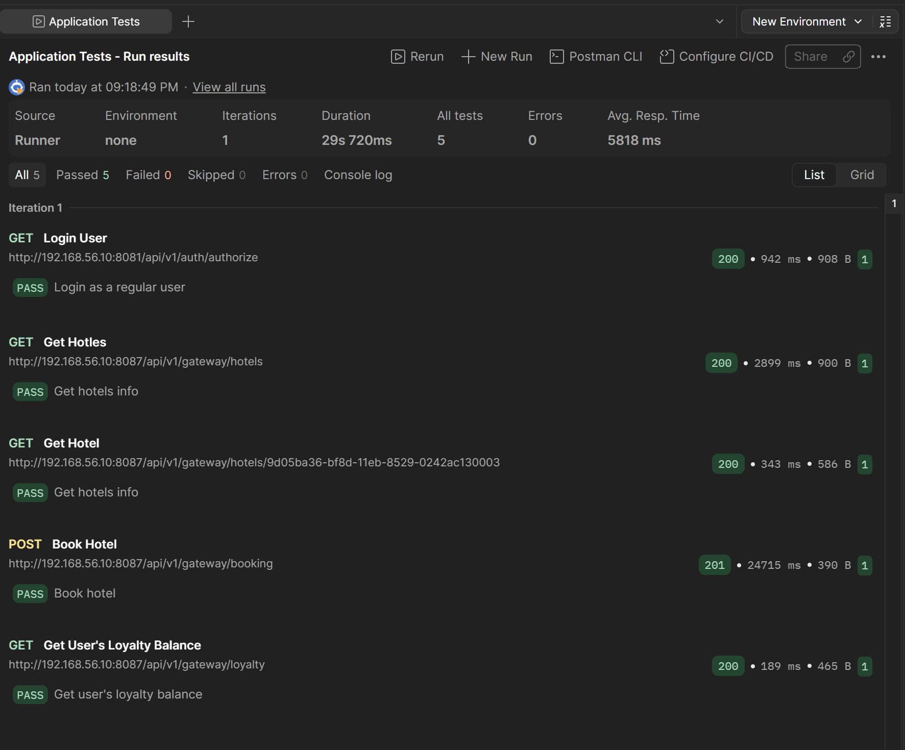 |
| Цели Prometheus: blackbox, cAdvisor ×3, node-exporter ×3 | 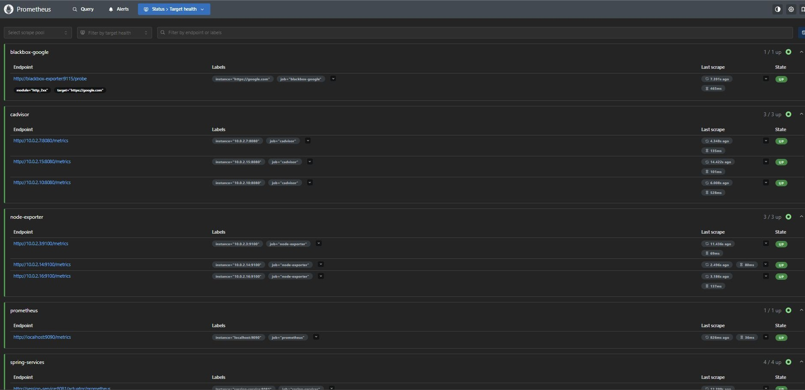 |
| 4 Java-сервиса с Micrometer | 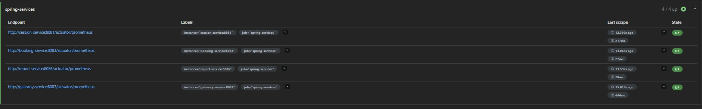 |
| Логи 10 сервисов в Loki | 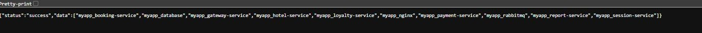 |
| Дашборд: 3 ноды, 23 контейнера, 2 стека, 12 CPU | 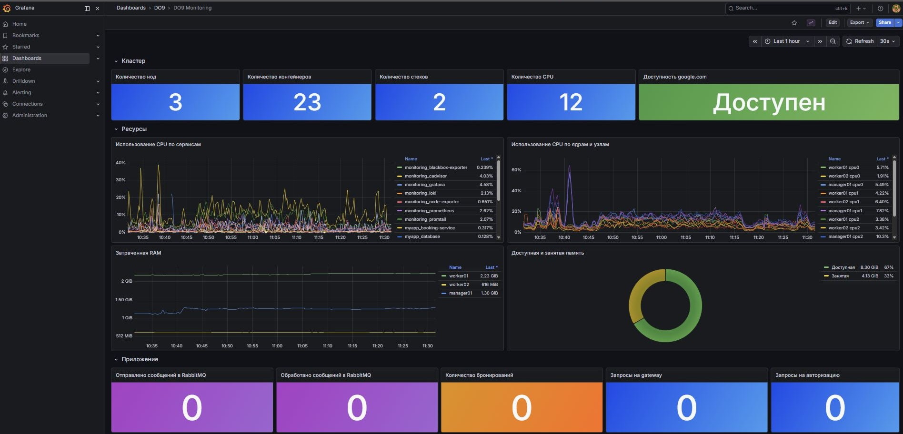 |
| Дашборд после бронирования: 61 / 61 / 1, логи | 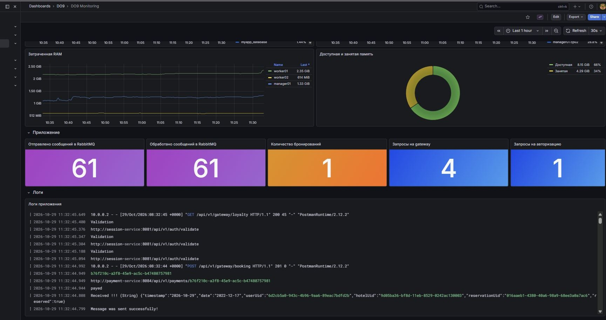 |
| `HighMemoryUsage` firing на 2 нодах | 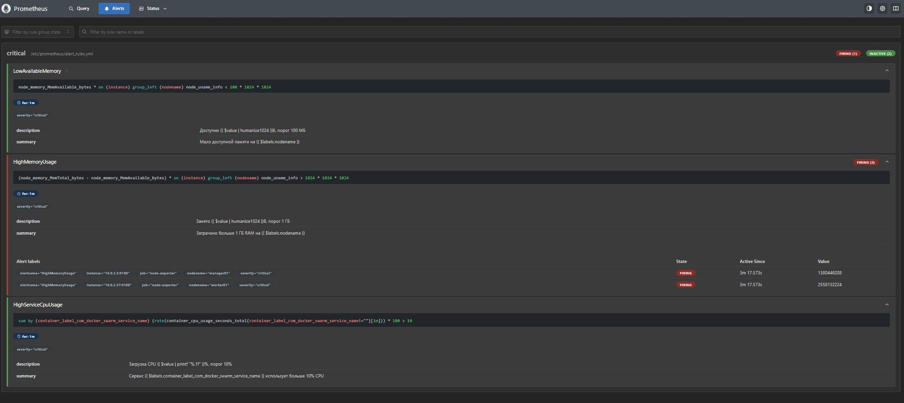 |
| Alertmanager сгруппировал алерты | 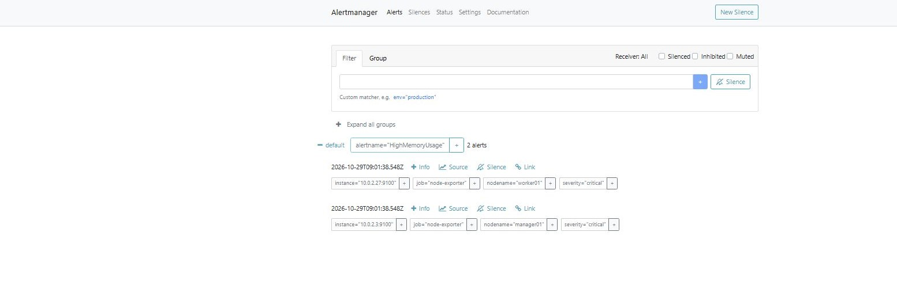 |
| Уведомление в Telegram | 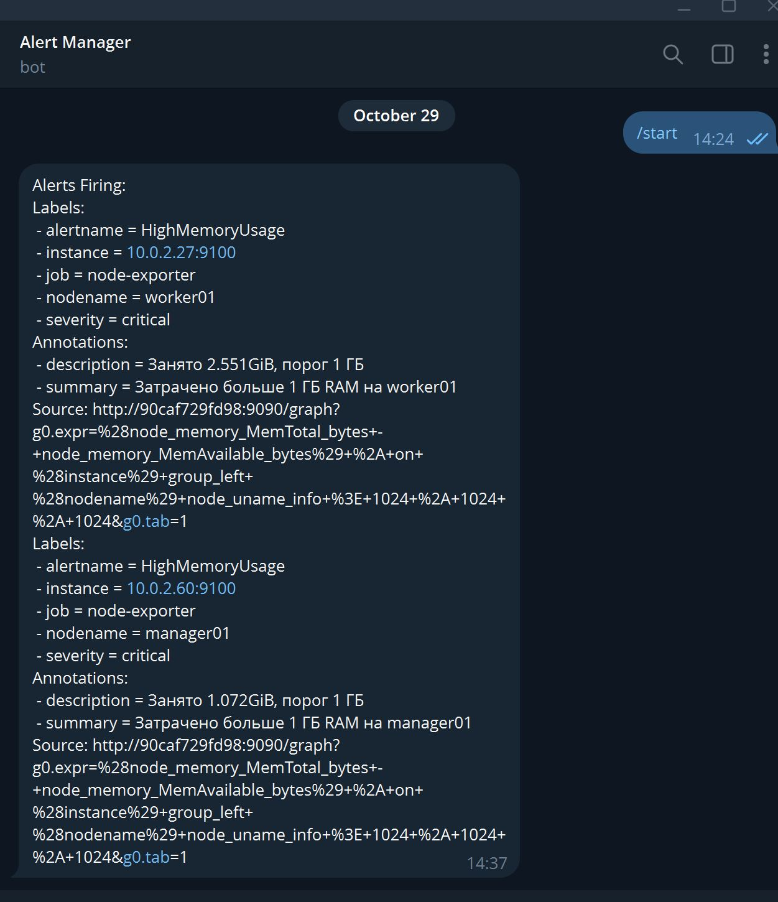 |
| Письмо Alertmanager | 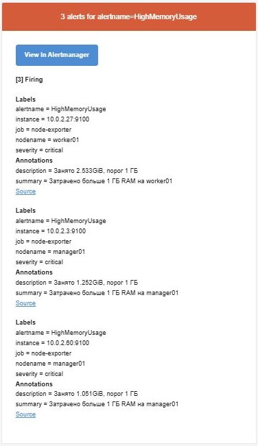 |

## Примечания

- **После ревью проверено на одной ноде, а не на 3 ВМ.** node-exporter, cAdvisor и Alloy работали в одном экземпляре, поэтому `count(node_uname_info) = 1`. Скриншоты с тремя нодами — из исходного прогона, тогда стоял Promtail, а не Alloy.
- **Реальная отправка уведомлений после ревью не проверялась.** Секреты в локальной проверке были фиктивными, Alertmanager честно пишет `Notify attempt failed`. Конфиг с `bot_token_file` и `chat_id_file` при этом загружается без ошибок. В исходном прогоне письма и сообщения в Telegram доходили — см. скриншоты.
- **Образы на Docker Hub собраны до чистки.** `aminblack/*` содержат старый ключ JWT, их нужно пересобрать командой из шага 2.
- **Пороги алертов учебные.** 1 ГБ RAM и 10% CPU заданы условием проекта, поэтому `HighMemoryUsage` срабатывает сразу. Для реального кластера пороги нужно поднять.
- **Grafana запускается с учётной записью `admin/admin` по умолчанию.** Для реального окружения пароль нужно задать через secret и `GF_SECURITY_ADMIN_PASSWORD__FILE`.
- **Хранение без репликации.** Loki и Prometheus хранят данные в локальных томах на manager01 (`placement: node.role == manager`), это одна инстанция без репликации.
- **cAdvisor `v0.55.1`** — последний тег в `gcr.io/cadvisor`. Более новые релизы (v0.56+) туда не публикуются.
